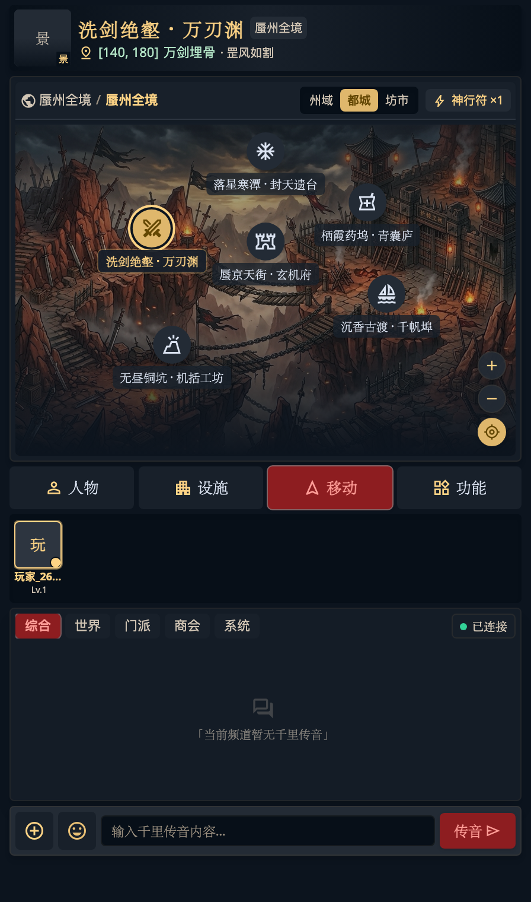
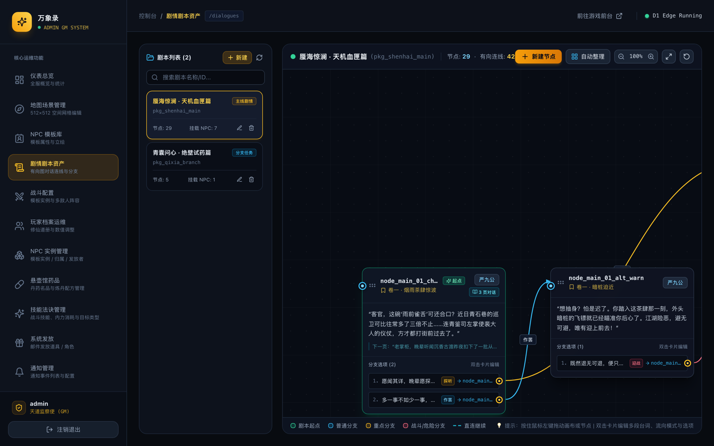

# 万象录 (Myriad Realms Chronicle) 🗺️

> 一款数据驱动的多世界剧情 RPG：既有文字 MUD 的叙事纵深，也有沉浸式视听与实时交互。
> 世界题材、地图、NPC、剧情与战斗全部由数据库与后台配置驱动——仙侠、奇幻、科幻、都市、废土……皆可自成一界。

技术栈：**React 18 + Vite + Zustand + Tailwind CSS** · **Cloudflare Workers + Hono + Durable Objects + D1** · **Yarn Workspaces (Monorepo)**

---

## 目录

- [一、游戏截图](#一游戏截图)
- [二、功能一览](#二功能一览)
  - [1. 游戏客户端](#1-游戏客户端)
  - [2. GM 管理后台](#2-gm-管理后台)
  - [3. Agent 内容生产技能](#3-agent-内容生产技能)
- [三、创建你自己的剧情](#三创建你自己的剧情)
  - [1. `.agents/skills` 是什么](#1-agentsskills-是什么)
  - [2. 从 0 到 1 的剧情创作流水线](#2-从-0-到-1-的剧情创作流水线)
  - [3. 方式一：让 AI Agent 直接创作](#3-方式一让-ai-agent-直接创作)
  - [4. 方式二：手动三步写剧本](#4-方式二手动三步写剧本)
  - [5. 剧本结构与常用能力](#5-剧本结构与常用能力)
  - [6. 验收：静态校验与 E2E 跑测](#6-验收静态校验与-e2e-跑测)
  - [7. 后台可视化编辑](#7-后台可视化编辑)
  - [8. 剧情设计规范（必读）](#8-剧情设计规范必读)
- [四、本地运行](#四本地运行)
- [五、延伸阅读](#五延伸阅读)
- [六、许可协议](#六许可协议)

---

## 一、游戏截图

<p align="center">
  
</p>
<p align="center">
  <sub>游戏客户端 · 世界大地图（当前示例世界：九州）：州域 / 都城 / 坊市三级坐标图、在线道友与千里传音（<code>http://localhost:3000/travel</code>）</sub>
</p>



<p align="center">
  <sub>GM 管理后台 · 剧情剧本资产：剧本包列表 + 有向图节点连线编辑器（<code>http://localhost:3001/dialogues</code>）</sub>
</p>

---

## 二、功能一览

### 1. 游戏客户端

| 模块 | 已实现能力 |
| :--- | :--- |
| **账号与进入** | 设备指纹静默免登录（首次进入自动创建游客档）、游客原地转正、与已有账号强事务合并、正式账号登录；全站移动端优先、桌面居中适配 |
| **角色与养成** | 人物主页、侠客全息档案（八维属性 / 境界 / 装备 / 江湖大事纪）、等级与修为、队伍整备（出战 / 休息）、乾坤行囊（使用 / 穿戴 / 整理 / 丢弃）、神兵法宝 / 心法招式 / 坐骑灵宠 / 天道命格等养成入口 |
| **世界大地图** | 任意题材的州域 → 都城 → 坊市三级地图（当前示例世界为「九州」）；点位、图标、层级、父子关系与底图全部由 D1 `scenes` 表驱动；点击地标查看场景详情与常驻 NPC；同城切换与跨州传送（消耗神行符或纹银）；在线道友列表、进 / 离场实时广播 |
| **剧情与任务** | 有向图对话引擎：节点内多页台词、线性直连、分支选项、条件展示 / 置灰、奖励与剧情 Flag、系统邮件与通知、剧情战斗、传送 / 入队动作；剧情指引与进行中任务入口 |
| **实时战斗** | WebSocket 实时回合制 PvE：剧情战与地图遭遇战、单人 / 多人战阵、技能策略结算（纯阳剑决 / 太清回春 / 九天引雷 / 平波剑法）、45 秒未操作自动普攻、战斗飘字与战报、胜负分支与奖励结算；支持道友切磋邀请与应战 |
| **生活与社交** | 悬壶馆（回春疗伤 / 购买丹药 / 丹药炼制）、聚宝钱庄、四方驿、万商集、长乐广场、城主府、演武场、听雨梨园等城内设施入口；飞鸽传书（邮件与附件领取）、好友 / 私信、世界 / 区域千里传音 |

### 2. GM 管理后台

| 模块 | 能力 |
| :--- | :--- |
| **仪表总览** | 全服玩家、正籍 / 散修、场景、NPC、技能等运营统计 |
| **地图场景管理** | 512×512 空间网格可视化编辑，场景层级 / 父子关系 / 坐标 / 图标 / 底图，点击画布新建与微调坐标，场景内 NPC 摆放 |
| **NPC 模板库** | 八维属性、成长模板、品质、立绘、战斗技能绑定 |
| **剧情剧本资产** | 剧本包 CRUD、节点与分支选项编辑、有向图可视化连线（拖拽 / 双击编辑 / 自动整理）、战斗与危险分支高亮；本次截图即为此模块 |
| **战斗配置** | 怪物组模板与多敌人战阵编排 |
| **玩家档案运维** | 全服玩家检索、境界战力与货币编辑、行囊归属、空间传送、系统发放 |
| **NPC 实例管理** | 模板实例台账：来源 / 归属玩家 / 发放者 / 状态 |
| **悬壶馆药品** | 丹药名品与炼丹配方管理 |
| **技能法诀管理** | 战斗技能、内力消耗、目标类型、技能数值 |
| **系统发放** | 通过系统邮件发放道具 / 角色 |
| **通知管理** | 玩家升级通知、剧情触发通知等通知事件配置 |


## 三、创建你自己的剧情

# 参考如下提示词：
# 创作任务：从零构建一个完整的原创游戏世界

你现在是一名顶级游戏主策划、世界观架构师、剧情编剧和游戏内容制作工程师。

你需要充分理解这几个 Skill 的实际能力、工作流程、API 约束和使用方式，并综合运用它们，为现有游戏创造一个全新的原创世界和一套真正可以游玩的剧情内容。

**这不是一项文案生成任务，而是一项实际的游戏内容创作与落地任务。**

---

## 一、创作方向

请完全自主决定新世界的题材、背景、故事主题和人物。

不需要询问我创作偏好。

要求：

- 世界观具有独创性，避免常见游戏套路。
- 有足够丰富的人物群像。
- 有复杂的人物关系和利益冲突。
- 有值得探索的地图和文化背景。
- 有大量可以实际体验的剧情、对话、战斗和探索事件。
- 故事具有文学性、情感深度和悬念。

不要把创作重心放在宏大设定上。

我更希望看到具体的人、具体的故事、具体发生的事情。

## 二、世界构建

先构建一个完整的世界，但不要停留在设定文档。

请至少设计：

- 5 个相互关联的势力。
- 6 个具有独立文化背景的区域。
- 12 个以上可以实际进入的地图场景。
- 8 名以上具有独立立绘和完整背景的核心人物。
- 15 名以上有明确身份和故事作用的 NPC。
- 多条彼此交织的故事线。

每个区域都要有自己的故事，不能仅仅作为主线剧情的背景板。

地图中的地点需要有文学气质、历史记忆和独特的文化特色。

例如一座桥、一家酒楼、一棵古树、一处废弃庭院，都可以承载独立的人物故事。

## 三、人物群像

人物塑造是本次创作的核心。

不要只设计主角和几个服务于主线的 NPC。

要建立一个真正的人物群像。

重点人物需要拥有：

- 独立的人生经历。
- 自己的目标和利益。
- 不愿公开的秘密。
- 性格中的矛盾。
- 与其他人物的关系。
- 独立的人物故事。
- 在主线和支线中的实际作用。

特别要求：

1. NPC 之间必须存在独立的关系和冲突。
2. 不同人物应该拥有不同的说话习惯。
3. 人物不能只在玩家需要时出现。
4. 某些人物可以在不同剧情线中反复出现。
5. 同一个人物在不同事件后，态度和对话应该发生变化。
6. 不要让所有人物都知道世界的全部真相。

## 四、剧情设计

请设计一条真正丰富的连续剧情。

至少包含：

- 1 条完整的核心主线。
- 6 条区域剧情。
- 8 条人物故事线。
- 15 条独立支线。
- 多个隐藏事件。
- 多个重要剧情转折。

剧情必须有实际内容。

每条重要剧情至少要明确：

- 发生地点。
- 参与人物。
- 事件起因。
- 人物动机。
- 事件经过。
- 玩家可以做出的选择。
- 选择造成的结果。
- 后续剧情如何受到影响。

特别注意人物之间的利益关系、信息差和因果联系。

不要采用简单的 NPC 发布任务、玩家完成任务、NPC 感谢玩家的流水线模式。

## 五、必须实际制作游戏内容

这是本次任务最重要的要求。

请使用三个 Skill，将创作成果真正写入游戏环境。

### 1. 角色资产

使用 character-sprite-design：

- 为重要人物设计独立立绘。
- 根据人物身份、性格、阵营和背景设计外观。
- 在 Stitch 中生成真实立绘。
- 下载并完成去背景处理。
- 登记到角色立绘库。
- 创建对应 NPC 模板。

不同人物必须具有视觉辨识度，不允许仅仅更换衣服颜色。

### 2. 地图场景

使用 map-scene-authoring：

- 创建完整的地图层级。
- 生成每个场景的真实背景图。
- 配置 background_url。
- 配置场景 ID、坐标、父子关系和描述。
- 将 NPC 放置到对应场景。
- 为每个场景设计独立的探索内容。

地图之间必须存在合理的空间关系。

不要创建只有名字和坐标、没有背景图片的空场景。

### 3. 剧情与交互

使用 dialogue-script-authoring：

- 创建完整剧本包。
- 创建大量实际对话节点。
- 配置多页台词。
- 配置玩家分支选项。
- 配置跨场景剧情推进。
- 配置条件判断和状态变化。
- 配置剧情战斗。
- 配置战斗胜利和失败后的不同剧情。
- 配置必要的通知和奖励。

至少实现：

- 20 个以上具有实际内容的对话节点。
- 30 个以上有意义的玩家选项。
- 6 场以上剧情战斗。
- 多条有实际分支的剧情路线。

不要把大量对话全部塞进一个节点。

合理拆分章节和节点，让剧情具有清晰的结构。

## 六、叙事质量

特别避免：

- 大段世界观介绍代替实际剧情。
- NPC 全员围绕主角转。
- 所有人物都使用相同的文学腔调。
- 人物只有身份，没有真实生活。
- 地图只有场景名称，没有故事。
- 战斗只是为了凑数量。
- 所有选择最后都导向相同结果。
- 为了反转而反转。
- 只有主线，没有值得探索的支线。

对话应该自然、有情绪、有潜台词。

允许人物沉默、撒谎、拒绝回答、转移话题。

允许某些剧情没有完美结局。

不要强迫每个故事都以玩家拯救所有人结束。

## 七、执行要求

不要先花大量篇幅写完世界观文档，然后结束任务。

请按照以下流程实际执行：

第一步：阅读三个 Skill 和相关参考文档，理解真实能力与限制。

第二步：检查现有游戏环境，获取现有场景、NPC 模板、立绘资源和剧本目录，避免 ID 冲突。

第三步：完成世界观、人物关系和剧情结构设计。

第四步：使用 Stitch 生成角色立绘和场景背景，并完成资产登记。

第五步：创建地图场景，配置地图层级和 NPC。

第六步：创建剧本包、节点、对话、分支和战斗。

第七步：检查所有剧情之间的连接关系，确保玩家可以实际体验完整流程。

第八步：通过 API 重新读取数据，验证实际创建结果。

每个阶段完成后都要检查执行结果。

如果遇到 Skill 或 API 限制，不要伪造成功结果，也不要直接放弃，先分析问题并尝试解决。

## 八、最终验收

最终我不关心你写了多少页设定文档，也不关心你调用了多少次工具。

我只关心最终游戏世界是否足够丰富。

请重点检查：

1. 是否有足够多的真实人物和人物立绘。
2. 是否有足够多的真实地图场景和背景。
3. 是否有丰富且有辨识度的人物关系。
4. 是否有多条真正独立的剧情线。
5. 是否有大量实际可玩的对话。
6. 是否有多场与故事紧密结合的战斗。
7. 是否有足够多的玩家选择和剧情反馈。
8. 所有剧本节点是否可以正确流转。
9. 所有场景和 NPC 是否正确关联。
10. 是否存在大量只有文字描述、实际并未创建的内容。

最后提供实际创建的资产、场景、NPC、剧本包、节点和选项 ID，以及验证结果。

**请把自己当成正在开发一款真正的游戏，而不是正在参加一场世界观设定文档比赛。创作质量优先于形式上的完整。**

## 四、本地运行

环境要求：Node.js >= 18、Yarn >= 1.22。

```bash
# 0. 准备本地密钥（首次运行；backend/.dev.vars 已被 .gitignore 忽略）
cp backend/.dev.vars.example backend/.dev.vars
#    编辑 backend/.dev.vars，将 JWT_SECRET 改为任意随机字符串

# 1. 安装依赖
yarn install

# 2. 初始化本地 D1 数据库（含建表与种子数据）
yarn d1:init

# 3. 分别启动三个服务
yarn dev:backend    # Cloudflare Workers 边缘后端  http://localhost:8787
yarn dev:frontend   # 游戏客户端                http://localhost:3000
yarn dev:admin      # GM 管理后台               http://localhost:3001
```

- 游戏客户端：`http://localhost:3000`（大地图页面：`http://localhost:3000/travel`）
- GM 管理后台：`http://localhost:3001`，默认管理员账号 `admin` / `admin123`
- 剧情剧本资产页面：`http://localhost:3001/dialogues`
- 首次进入游戏会按设备指纹静默创建游客角色，无需注册

### 素材说明

为控制仓库体积，`frontend/public/assets/combat/characters/`（角色立绘，约 42MB / 41 个文件）**未纳入版本库**：

- 本地开发：把立绘文件放入该目录即可（`*_trans.png` 为去背景版本）；
- 重新生成：使用 `character-sprite-design` Skill 按地图世界观设计、生成，并自动下载 / 转码 / 去背景 / 入库。

地图底图（`frontend/public/assets/maps/`）已随仓库提供。

构建与部署：

```bash
yarn build:frontend   # 游戏前端产物 frontend/dist/
yarn build:admin      # 后台产物 admin/dist/
yarn deploy:backend   # 部署后端至 Cloudflare（需先配置 wrangler.toml 的 d1 database_id）
```

> 敏感配置不写入 `wrangler.toml`，生产环境使用 Cloudflare Secret 注入：
> ```bash
> cd backend && npx wrangler secret put JWT_SECRET
> cd backend && npx wrangler secret put ADMIN_PASSWORD   # 覆盖本地默认的 admin / admin123
> ```

---

## 五、延伸阅读

| 文档 | 内容 |
| :--- | :--- |
| [`docs/dialogue-script-authoring.md`](docs/dialogue-script-authoring.md) | 剧本 API 完整技术文档与字段规范 |
| [`docs/map-hierarchy-plan.md`](docs/map-hierarchy-plan.md) | 地图层级与州域 / 都城 / 坊市规划 |
| [`docs/npc-attribute-growth-design.md`](docs/npc-attribute-growth-design.md) | NPC 八维成长、品质与境界计算 |
| [`docs/npc-battle-encounter-design.md`](docs/npc-battle-encounter-design.md) | 地图遭遇战与战阵设计 |
| [`docs/npc-solo-encounter-design.md`](docs/npc-solo-encounter-design.md) | 单人遭遇战设计 |
| [`docs/player-level-notification-design.md`](docs/player-level-notification-design.md) | 玩家升级通知设计 |
| [`docs/system-grant-design.md`](docs/system-grant-design.md) | 系统邮件发放设计 |

---

## 六、许可协议

本项目基于 **MIT License** 开源，详见 [LICENSE](LICENSE)。
