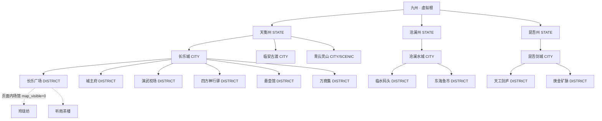

# 州域 · 都城 · 坊市 联动改造方案

> 目标：把「州域 → 都城 → 坊市」从**三块互不相干的手写 UI + 手写字典**，改造成**一棵数据库里的场景树**。
> 地图、面包屑、传送、在线状态、城内设施页、广场页，全部从这棵树派生，只保留一个事实来源。

---

## 一、结论先行

当前不是“联动做得不好”，而是**根本没有可联动的数据结构**：

- `scenes` 表只有 `region` 这个**文本标签**，没有 `parent_id`，所以“长乐城属于天衡州”在库里不存在；
- `TravelMapScreen` 的三层节点是**写死的 JSX**，切层时固定跳到 `tianheng / changle / square`；
- “哪个 key 属于哪个州、哪个大区”被抄在 **4 个地方**（`getLevelByKey`、`isCrossZone`、`SCENE_ALIASES`、`ZONE_CONFIG`），任何一处改动都会漂移；
- `scenes.zone_id` 这个唯一沾边的层级字段，**种子数据压根没写**，17 行全部落到默认值 `changle_city`，等于没有；
- 同一地点被存了两份（`tianheng` / `tianheng_state`、`changle` / `changle_city`…），前端把其中一份当“州”，后端把另一份当“场景”，天然对不上。

改造的核心不是补页面，而是**先立树，再让所有入口读同一棵树**。

---

## 二、现状诊断（带证据）

### 2.1 数据层：没有层级，只有文本

[backend/schema.sql](backend/schema.sql:203) 的 `scenes` 表：

```sql
CREATE TABLE scenes (
    id TEXT PRIMARY KEY,
    zone_id TEXT NOT NULL DEFAULT 'changle_city',  -- 所属大区
    name TEXT NOT NULL,
    region TEXT NOT NULL,                          -- 只是展示文本“天衡州”
    coord_x INTEGER, coord_y INTEGER,
    ...
);
```

问题：

1. **没有 `parent_id`**：无法回答“长乐城下面有哪些坊市”“沧澜州有哪些都城”。
2. **`region` 是字符串不是外键**：`'天衡州'` 和 `'大禹皇朝'` 混用，且 `tianheng` 的 `region` 是“大禹皇朝”，`changle` 的 `region` 是“天衡州”，父子关系靠肉眼。
3. **种子 INSERT 没有 `zone_id` 列**（[schema.sql:254](backend/schema.sql:254)），17 行全部使用默认值 `changle_city`。也就是说 `zone_id` 目前是死字段。
4. **重复地理行**：`tianheng` / `tianheng_state`、`canglan` / `canglan_state`、`kunwu` / `kunwu_state`、`qingyun` / `qingyun_state`、`changle` / `changle_city` 坐标完全相同，是同一地点的两个 key。哪个 key 代表“州”、哪个代表“场景”，前后端理解不一致。
5. **层级数据严重不完整**：只有天衡州有“都城 → 坊市”；沧澜州只有一个州节点，昆吾州只有一个 `forge`，青云灵山下面没有子节点。

### 2.2 接口层：各查各的，互不关联

- `/api/map` 和 `/api/map/:mapId` 都**不返回 `zone_id`、不返回父子关系**，只返回展示字段（[mapRoutes.ts:17](backend/src/routes/mapRoutes.ts:17)、[mapRoutes.ts:78](backend/src/routes/mapRoutes.ts:78)）。前端拿到全量场景也拼不出树。
- `mapRoutes` 里维护一份别名表 `SCENE_ALIASES`（[mapRoutes.ts:40](backend/src/routes/mapRoutes.ts:40)），`travel.ts` 里又维护一份 `ZONE_CONFIG`（[travel.ts:11](backend/src/routes/travel.ts:11)），前端还有第三份 `getLevelByKey`（[TravelMapScreen.tsx:28](frontend/src/pages/TravelMapScreen.tsx:28)）。
- `ZONE_CONFIG` 已经出现明显错误：`forge`（天工剑庐，`region = 昆吾州`）被映射到 `changle_city`（[travel.ts:23](backend/src/routes/travel.ts:23)）；`qingyun` 被映射成独立大区 `qingyun_state`，但它在地图上是天衡州的二级地点。
- 地图列表把所有场景的 `onlineCount` 直接写成 `1`（[mapRoutes.ts:35](backend/src/routes/mapRoutes.ts:35)），只有单场景接口才查 DO。

### 2.3 前端地图：三层是“三套写死的页面”

[TravelMapScreen.tsx](frontend/src/pages/TravelMapScreen.tsx:1)：

- 一级固定三个 `<button>`：天衡/沧澜/昆吾（第 259–335 行）；
- 二级固定“天衡州”的三个地点：长乐城/临安古渡/青云灵山（第 339–415 行），**无论从哪个州点进来都是天衡州**；
- 三级固定“长乐城内”的四个地点：广场/城主府/演武校场/四方神行驿（第 419–521 行）；
- 面包屑固定写死“九州总览 / 天衡州 / 长乐城”（第 168–196 行）；
- 三个层级 Tab 点击后固定 `setSelectedKey('tianheng' | 'changle' | 'square')`（第 168–239 行）；
- `getLevelByKey` 把 `qingyun` 当二级，但 `qingyun_state` 落到 `else` 变三级；如果玩家在 `qingyun_state`，地图会显示“长乐城内”的节点。

也就是说：**选中态、层级态、玩家所在态是三个独立变量**，互相不推导，所以点任何地方都不会真正“联动”。

### 2.4 传送与在线状态：两套语义

- 同大区移动：前端发 WS `SCENE/CHANGE_AREA`（[TravelMapScreen.tsx:128](frontend/src/pages/TravelMapScreen.tsx:128)），`ZoneDO` 只改内存 + 广播（[ZoneDO.ts:325](backend/src/durable_objects/ZoneDO.ts:325)），**不写 `players.area_id`**，只在断线时写一次（[ZoneDO.ts:543](backend/src/durable_objects/ZoneDO.ts:543)）。刷新页面会回到旧地点。
- 跨州移动：走 `POST /api/travel/teleport`，事务里同时改 `zone_id + area_id`（[travel.ts:133](backend/src/routes/travel.ts:133)）。但它判断“是否同大区”靠 `ZONE_CONFIG`，不是靠场景树。
- WS 网关把所有大区塞进同一个 DO：`idFromName('global_game_world')`（[index.ts:51](backend/src/index.ts:51)）。`useWebSocket.connect` 甚至没有把 `zoneId` 拼进连接 URL（[useWebSocket.ts:111](frontend/src/hooks/useWebSocket.ts:111)），服务端 `this.zoneId` 会被每次握手覆盖。**“大区隔离”目前只是字段，不是事实。**
- `index.ts` 把 `ZoneDO` 同时导出为 `MapDO`（[index.ts:16](backend/src/index.ts:16)），真正的 [MapDO.ts](backend/src/durable_objects/MapDO.ts:1) 没有被使用；MapDO 也没有注册 `SCENE` 处理器，如果绑定切过去，`CHANGE_AREA` 会被静默丢弃。

### 2.5 页面层：地图节点和功能页是两套数据

- [CityFacilitiesScreen.tsx](frontend/src/pages/CityFacilitiesScreen.tsx:27) 手写 8 个设施；其中“聚宝钱庄 / 万商集 / 听雨梨园”在 `scenes` 表里**没有对应节点**，其余名称（四方驿 vs 四方神行驿、演武场 vs 演武校场、城主府 vs 长乐城主府）也只是碰巧相似，不是同一份数据。
- [ChangleSquareScreen.tsx](frontend/src/pages/ChangleSquareScreen.tsx:35) 手写 6 个场馆；`square` 场景只有一条记录，6 个场馆在库里没有对应节点。
- 地图上“前往长乐广场”之后只是把 `areaId` 改成 `square`，**不会跳到 `/square` 页面**；从设施页点“长乐广场”才 `navigate('/square')`（[CityFacilitiesScreen.tsx:120](frontend/src/pages/CityFacilitiesScreen.tsx:120)）。地图与页面路由之间没有契约。

---

## 三、目标设计

### 3.1 一句话模型

> **一张自引用树表 `scenes`，节点用 `parent_id` 挂成 州域 → 都城 → 坊市 → 场馆；`zoneId` 从根节点继承；移动 = “移动到节点”，界面层级 = “节点的祖先链”。**



关键约定：

| 约定 | 说明 |
| :--- | :--- |
| `parent_id IS NULL` | 根节点 = 州域，也是运行时的 `zone` |
| `depth` | 0=州域，1=都城/地点，2=坊市/街区，3=页面内场馆（可选） |
| `zone_id` | **只在根节点上有意义**，所有后代继承根的 `zone_id`；用于 WS/DO 分片 |
| `map_visible` | 1=出现在地图节点上；0=只作为页面内条目（如广场里的 6 个场馆） |
| `entry_route` | 进入该节点后跳转的页面（`/square`、`/facility`…），没有就留在当前页 |
| `is_open` | 未开放节点仍显示但不可前往，避免“空层” |
| 叶子/分支 | 不看 `node_type`，只看**是否有 `map_visible=1` 的子节点**；有子节点 = 可下钻，无子节点 = 可前往 |

> `node_type` 只用于图标和视觉分组（STATE/CITY/DISTRICT/VENUE），**不参与层级逻辑**，这样以后加“洞天/秘境/海岛”不用改代码。

### 3.2 唯一事实来源

```text
D1 scenes 树
   ├─ GET /api/map/tree ──────────────► useMapStore（节点表 + 父子索引）
   ├─ GET /api/map/:id ───────────────► 当前节点 + path + children + NPC + 在线数
   ├─ POST /api/travel/preview ───────► 路费/耗时/条件
   └─ POST /api/travel/move ──────────► 权威移动（写 players + 通知 DO）

useMapStore
   ├─ currentId  → 玩家所在地（服务端权威）
   ├─ focusId    → 地图上正在查看的节点
   ├─ viewId     → 当前画布展示的是“谁的子节点”（null = 九州）
   ├─ pathOf(id) → 面包屑 / Tab / 层级
   └─ childrenOf(viewId) → 地图节点渲染

页面
   ├─ TravelMapScreen  ← childrenOf(viewId)
   ├─ CityFacilities   ← childrenOf(当前 CITY)
   ├─ ChangleSquare    ← childrenOf(square) 中 map_visible=0 的场馆
   └─ MainPersonScreen ← currentId 的 NPC
```

---

## 四、数据层方案

### 4.1 表结构增量

保留 `scenes` 表名，减少改动面：

```sql
-- 005_map_tree.sql
ALTER TABLE scenes ADD COLUMN parent_id   TEXT REFERENCES scenes(id);
ALTER TABLE scenes ADD COLUMN node_type   TEXT NOT NULL DEFAULT 'DISTRICT';
ALTER TABLE scenes ADD COLUMN map_x       REAL;              -- 0..100，相对父级画布
ALTER TABLE scenes ADD COLUMN map_y       REAL;
ALTER TABLE scenes ADD COLUMN sort_order  INTEGER NOT NULL DEFAULT 0;
ALTER TABLE scenes ADD COLUMN icon        TEXT;              -- material symbol 名
ALTER TABLE scenes ADD COLUMN entry_route TEXT;              -- /square, /facility?scene=...
ALTER TABLE scenes ADD COLUMN map_visible INTEGER NOT NULL DEFAULT 1;
ALTER TABLE scenes ADD COLUMN is_open     INTEGER NOT NULL DEFAULT 1;
ALTER TABLE scenes ADD COLUMN meta_json   TEXT;              -- 页面内场馆的 chips 等扩展

-- 后期“可配置”用的扩展位（P0 一起加，避免二次改表）
ALTER TABLE scenes ADD COLUMN bg_url          TEXT;          -- 该层底图（挂在父节点上生效）
ALTER TABLE scenes ADD COLUMN map_meta_json   TEXT;          -- 视口/缩放/标记样式
ALTER TABLE scenes ADD COLUMN unlock_condition TEXT;         -- JSON: {"level":20,"flag":"..."}
ALTER TABLE scenes ADD COLUMN travel_cost_json TEXT;         -- 节点级路费覆盖，空则按树距离算

CREATE INDEX idx_scenes_parent ON scenes(parent_id, sort_order);
CREATE INDEX idx_scenes_type   ON scenes(node_type);

-- 旧 key → 规范 id，兼容存量数据和旧链接
CREATE TABLE scene_aliases (
    alias    TEXT PRIMARY KEY,
    scene_id TEXT NOT NULL REFERENCES scenes(id) ON DELETE CASCADE
);

-- 非树形的额外通路：传送阵/城门/密道/单向路/捷径
-- 树负责“归属与层级”，link 负责“任意两点之间的边”，两者不要混用
CREATE TABLE scene_links (
    id               TEXT PRIMARY KEY,
    from_id          TEXT NOT NULL REFERENCES scenes(id) ON DELETE CASCADE,
    to_id            TEXT NOT NULL REFERENCES scenes(id) ON DELETE CASCADE,
    link_type        TEXT NOT NULL DEFAULT 'PORTAL',   -- PORTAL/GATE/PATH/SECRET
    is_bidirectional INTEGER NOT NULL DEFAULT 1,
    cost_json        TEXT,                             -- {"item":"item_teleport_rune","count":1}
    condition_json   TEXT,                             -- {"level":30,"quest":"q_xxx"}
    sort_order       INTEGER NOT NULL DEFAULT 0
);

CREATE INDEX idx_scene_links_from ON scene_links(from_id);
```

> 这 4 个 `scenes` 扩展字段 + `scene_links` 是**为后期配置留的插槽**，P0 阶段不填值也能跑。没有它们，后期每加一种“传送阵/单向门/换底图/等级锁”都要再改一次表和服务层。

> `coord_x/coord_y` 保留（世界坐标/详情展示），`map_x/map_y` 专门负责“在当前层画布上的百分比位置”。两者不要混用，否则换背景图就要重算。

### 4.2 规范 id 与种子重排

原则：**一个地理实体只保留一个 id**。`*_state` 一律进别名表，不再作为场景行。

| id | parent | type | name | map 坐标 | entry_route | 备注 |
| :--- | :--- | :--- | :--- | :--- | :--- | :--- |
| `tianheng` | — | STATE | 天衡州 | 50,45 | | zone=`tianheng_state` |
| `canglan` | — | STATE | 沧澜州 | 82,55 | | zone=`canglan_state` |
| `kunwu` | — | STATE | 昆吾州 | 18,65 | | zone=`kunwu_state` |
| `changle` | tianheng | CITY | 长乐城 | 50,50 | `/facility` | 原 `changle` / `changle_city` 合并 |
| `linan` | tianheng | CITY | 临安古渡 | 82,30 | | 原 `linan` |
| `qingyun` | tianheng | CITY | 青云灵山 | 22,20 | | 原 `qingyun` / `qingyun_state` 合并 |
| `canglan_city` | canglan | CITY | 沧澜水城 | 50,50 | `/facility` | 新增占位 |
| `kunwu_city` | kunwu | CITY | 昆吾剑城 | 50,50 | `/facility` | 新增占位 |
| `square` | changle | DISTRICT | 长乐广场 | 50,55 | `/square` | |
| `manor` | changle | DISTRICT | 长乐城主府 | 50,15 | | |
| `arena` | changle | DISTRICT | 演武校场 | 20,30 | | |
| `post` | changle | DISTRICT | 四方神行驿 | 22,78 | | |
| `pharmacy` | changle | DISTRICT | 悬壶馆 | 35,45 | | |
| `market` | changle | DISTRICT | 万商集 | 65,42 | | 新增，补设施页缺口 |
| `bank` | changle | DISTRICT | 聚宝钱庄 | 78,60 | | 新增，补设施页缺口 |
| `forge` | kunwu_city | DISTRICT | 天工剑庐 | 50,50 | | **从 changle 改挂昆吾** |
| `linan_dock` | linan | DISTRICT | 古渡码头 | 50,55 | | 新增 |
| `qingyun_gate` | qingyun | DISTRICT | 青云山门 | 50,55 | | 新增 |
| `canglan_dock` | canglan_city | DISTRICT | 临水码头 | 35,55 | | 新增 |
| `canglan_market` | canglan_city | DISTRICT | 东海鱼市 | 65,45 | | 新增 |
| `kunwu_mine` | kunwu_city | DISTRICT | 庚金矿脉 | 30,55 | | 新增 |
| `kunwu_arena` | kunwu_city | DISTRICT | 论剑坪 | 70,50 | | 新增 |

页面内场馆（不在地图显示）：

| id | parent | name | map_visible |
| :--- | :--- | :--- | :--- |
| `venue_casino` | square | 玲珑坊 | 0 |
| `venue_teahouse` | square | 听雨茶楼 | 0 |
| `venue_stage` | square | 百戏台 | 0 |
| `venue_market` | square | 珍宝摊 | 0 |
| `venue_notice` | square | 江湖告示栏 | 0 |

> 这样 `CityFacilitiesScreen` 的 8 宫格和地图三级的坊市节点就是**同一批行**，`ChangleSquareScreen` 的 6 个场馆也有库可查。新增一个坊市只要插一行，两个页面同时出现。

### 4.3 别名表数据

```sql
INSERT INTO scene_aliases (alias, scene_id) VALUES
  ('tianheng_state', 'tianheng'),
  ('canglan_state',  'canglan'),
  ('kunwu_state',    'kunwu'),
  ('qingyun_state',  'qingyun'),
  ('changle_city',   'changle'),
  ('main',           'square'),
  ('peak',           'qingyun'),
  ('dock',           'linan');
```

注意 `dock` 建议映射到 `linan`（临安古渡）而不是现在的 `canglan`，因为 `dock` 的语义是渡口；这是一处**有意的行为修正**，迁移时要在 PR 说明。

### 4.4 存量数据迁移顺序

```sql
-- 1. 加列（见 4.1）
-- 2. 写入新树（新 id 插行；旧行 UPDATE parent/type/map_x/map_y）
-- 3. players.area_id 规范化
UPDATE players
SET area_id = (SELECT scene_id FROM scene_aliases a WHERE a.alias = players.area_id)
WHERE area_id IN (SELECT alias FROM scene_aliases);

-- 4. 解除旧行引用后再删重复地理行
DELETE FROM scenes WHERE id IN ('tianheng_state','canglan_state','kunwu_state','qingyun_state','changle_city');
```

迁移后加一条**种子自检 SQL**（CI 或启动脚本执行）：

```sql
-- 非根节点必须有父；父必须存在；zone 必须与根一致
SELECT child.id
FROM scenes child
LEFT JOIN scenes parent ON parent.id = child.parent_id
WHERE child.parent_id IS NOT NULL AND parent.id IS NULL;

-- 每个根下至少一个子节点（避免空层）
SELECT root.id FROM scenes root
LEFT JOIN scenes child ON child.parent_id = root.id
WHERE root.parent_id IS NULL AND child.id IS NULL;
```

---

## 五、服务端方案

### 5.1 新增 `sceneService.ts`（唯一地图领域服务）

职责：

```ts
resolveScene(idOrAlias): SceneNode | null
getTree(): SceneNode[]                    // 嵌套，一次性返回
getPath(id): SceneNode[]                  // 祖先链（含自身），用于面包屑/层级
getChildren(id, {visibleOnly}): SceneNode[]
getRoot(id): SceneNode                    // 州域，决定 zoneId
getZoneId(id): string
getTravelQuote(fromId, toId): TravelQuote // 距离、路费、耗时、条件
movePlayer(playerId, toId): MoveResult    // D1 事务 + DO 通知
```

`movePlayer` 伪代码：

```ts
const target = resolveScene(toId);
const from   = resolveScene(player.area_id);
if (!target?.is_open) throw new BadRequest('该地点尚未开放');
if (from.id === target.id) return { mode: 'noop', ... };

const fromRoot = getRoot(from.id);
const toRoot   = getRoot(target.id);
const crossZone = fromRoot.id !== toRoot.id;

// 路费：同州内按树距离；跨州固定（沿用现有神行符×1 / 纹银 500）
const quote = getTravelQuote(from.id, target.id);

const stmts = [];
if (quote.item) stmts.push(/* 扣神行符，不足则银两，原子条件 */);
stmts.push(
  db.prepare('UPDATE players SET zone_id = ?, area_id = ?, updated_at = CURRENT_TIMESTAMP WHERE id = ?')
    .bind(toRoot.zone_id, target.id, playerId)
);
await db.batch(stmts);          // 扣费 + 位置在同一事务

// 通知 DO：老房间 leave，新房间 enter（跨州时两个 DO 都要通知）
await notifyPresence(fromRoot.zone_id, { type: 'LEAVE', playerId, sceneId: from.id });
if (crossZone) {
  await notifyPresence(toRoot.zone_id, { type: 'ENTER', playerId, sceneId: target.id, path: getPath(target.id) });
}
return { mode: crossZone ? 'cross' : 'intra', zoneId: toRoot.zone_id, sceneId: target.id, path: getPath(target.id), quote };
```

注意：

- **扣费与位置必须同一个 `db.batch`**，避免扣了钱没落地；
- 同州移动也要写 `players.area_id`，不要依赖断线时持久化；
- 已在该节点时幂等返回，不重复扣费；
- 目标必须是 `is_open=1` 的叶子或分支，服务端不信任前端传的 zone。

### 5.2 API 契约

| 方法 | 路径 | 作用 |
| :--- | :--- | :--- |
| GET | `/api/map/tree` | 一次性返回整棵树（含 `parentId/depth/zoneId/mapX/mapY/entryRoute/children`） |
| GET | `/api/map/:id` | 单节点详情：`scene + path + children + npcs + onlineCount`（保留旧字段兼容） |
| POST | `/api/travel/preview` | `{ targetSceneId }` → 路费、耗时、是否跨州、是否可前往 |
| POST | `/api/travel/move` | 权威移动，返回 `{ mode, zoneId, sceneId, path, quote, player }` |
| POST | `/api/travel/teleport` | **保留为 `/move` 的兼容包装**，内部不再维护 `ZONE_CONFIG` |

`GET /api/map/tree` 响应示例：

```json
{
  "version": 3,
  "nodes": [
    {
      "id": "tianheng",
      "parentId": null,
      "type": "STATE",
      "name": "天衡州",
      "zoneId": "tianheng_state",
      "depth": 0,
      "mapX": 50,
      "mapY": 45,
      "entryRoute": null,
      "isOpen": true,
      "children": [
        {
          "id": "changle",
          "parentId": "tianheng",
          "type": "CITY",
          "name": "长乐城",
          "zoneId": "tianheng_state",
          "depth": 1,
          "mapX": 50,
          "mapY": 50,
          "entryRoute": "/facility",
          "children": [
            { "id": "square", "type": "DISTRICT", "name": "长乐广场", "depth": 2, "mapX": 50, "mapY": 55, "entryRoute": "/square" }
          ]
        }
      ]
    }
  ]
}
```

> 前端只吃这一个响应就能画三层；`/api/map/:id` 用于进入场景后刷新 NPC/在线数，不再承担“拼层级”的职责。

### 5.3 WS / 在线状态修正

1. **连接必须带 zone**：`/api/ws/zone?zoneId=...&areaId=...&playerId=...`；`connect()` 把 `zoneId` 拼进 URL（当前完全丢弃了它）。
2. **网关按 zone 分片**：`idFromName(zoneId)`，而不是固定 `global_game_world`。这样“沧澜州玩家看不到天衡州本地频道”才是真的。
3. **`CHANGE_AREA` 降级为投影**：位置变更以 `POST /api/travel/move` 为准；前端移动成功后只负责 `ws.reconnect(zoneId, areaId)`（同州可复用连接并补发一次 presence）。DO 不再作为位置的唯一写入方。
4. **DO 不再只在断线时持久化**：位置已由 move 接口写入；断线持久化保留为兜底，但要读 DO 内存里的最新 `areaId`，避免用旧值覆盖。
5. **world 频道**：全服广播走 `WorldChatDO`；`zone` 频道走当前 zone DO；`local` 频道按 `areaId`。现在 `broadcast()` 是“全 DO”，跨州公告会串台。

---

## 六、前端方案

### 6.1 `useMapStore` 重构（核心）

```ts
interface MapState {
  nodes: Record<string, MapNode>;     // 扁平索引，含 childrenIds
  roots: string[];
  currentId: string | null;           // 玩家所在地（服务端权威）
  focusId: string | null;             // 正在查看的节点
  viewId: string | null;              // 当前画布 = 谁的子节点；null = 九州
  isLoading: boolean;

  loadTree(): Promise<void>;
  enterScene(id: string): Promise<MoveResult>;  // 调 /move，成功后同步 player + ws + 路由
  focus(id: string): void;
  zoomIn(): void;
  zoomOut(): void;
  goToLevel(level: number): void;
  resetToCurrent(): void;

  pathOf(id: string | null): MapNode[];
  childrenOf(viewId: string | null): MapNode[];
  levelOf(id: string | null): number;
  isCurrent(id: string): boolean;
}
```

约定：

- `viewId = parentOf(focusId)`；`focusId` 是州时 `viewId = null`（画九州）。
- `levelOf(id) = pathOf(id).length - 1`；`null` 的层级是 `-1`（九州）。
- **`currentId` 与 `focusId` 分离**：玩家在广场时，可以点开“沧澜州”看详情而不改变所在地；地图上的“我的位置”标记始终按 `currentId` 画。
- 刷新恢复：`loadTree()` 后用 `player.areaId` → 别名解析 → `currentId`，再 `focusId = currentId`、`viewId = parentOf(currentId)`。这样刷新后层级、面包屑、选中态一次到位，不再依赖写死的 `getLevelByKey`。

### 6.2 `TravelMapScreen` 改造

删除：

- `getLevelByKey`、`isCrossZone`、三套 `mapLevel === 1/2/3` 的 JSX 块、写死的面包屑和 Tab 目标。

替换为：

```tsx
const viewNodes = useMapStore(s => s.childrenOf(s.viewId));
const path = useMapStore(s => s.pathOf(s.focusId));

// 面包屑：九州 / 天衡州 / 长乐城 / 长乐广场
<Breadcrumb items={[{ id: null, name: '九州' }, ...path]} onSelect={(id) => {
  focus(id); // viewId 自动变成 parentOf(id)
}} />

// 画布：所有层级共用同一个节点组件
{viewNodes.map(node => (
  <MapNodeMarker
    key={node.id}
    node={node}
    isCurrent={node.id === currentId}
    isFocused={node.id === focusId}
    onClick={() => { focus(node.id); openDialog(node); }}
    style={{ left: `${node.mapX}%`, top: `${node.mapY}%` }}
  />
))}
```

行为：

| 操作 | 行为 |
| :--- | :--- |
| 点击节点 | `focus(node)` + 打开详情弹窗；不改变所在地 |
| 弹窗「下钻」 | 有可见子节点时 `focus(firstChild)`，画布进入下一层 |
| 弹窗「前往」 | `enterScene(node.id)`：先 `/travel/preview` 显示路费，再 `/travel/move`；成功后 `currentId` 更新、`ws.reconnect`、`viewId = parentOf(currentId)` |
| 面包屑 | 点击任意祖先，`focus` 该节点，画布显示其子节点 |
| 层级 Tab | 由 `path` 动态生成（州域/都城/坊市/…），点击 = 选中该层祖先；没有该层就禁用，而不是硬跳 `square` |
| `+` / `-` | 下钻到第一个子节点 / 上浮到父节点；到顶/到底时禁用 |
| `my_location` | `focus = current`，`view = parentOf(current)` |
| 进入带 `entryRoute` 的节点 | 移动成功后 `navigate(entryRoute)`（如广场 → `/square`，都城 → `/facility`） |

这样“州域/都城/坊市”不再靠 `mapLevel` 数字，而是靠**树深度**，加一层“秘境/洞府”不用改地图组件。

### 6.3 页面与地图共用同一棵树

**`CityFacilitiesScreen`**

```tsx
const city = useMapStore(s => s.pathOf(s.currentId).find(n => n.type === 'CITY'));
const facilities = useMapStore(s => s.childrenOf(city?.id ?? null));
```

- 8 宫格改为 `facilities.map(...)`，字段取 `name / tag / subtitle / description / icon`；
- 点击设施 → `enterScene(fac.id)`（真正移动）→ 再打开对应弹窗；
- 删除手写数组；`聚宝钱庄 / 万商集 / 听雨梨园` 如果暂时没有内容，就在种子里加节点并标 `is_open=0`，UI 显示“筹备中”，而不是从数组里消失。

**`ChangleSquareScreen`**

```tsx
const venues = useMapStore(s => s.childrenOf('square').filter(n => !n.mapVisible));
```

- 6 个场馆从 `venue_*` 节点读取（`meta_json` 存 chips/actionNotice）；
- 页头标题取 `currentScene.name`，不再写死“长乐广场”；
- 返回按钮 `navigate('/facility')` 改为“返回父节点对应的页面”，避免以后广场挂到别的城就失效。

**`TopSceneHeader` / 底部 HUD**

- 展示 `pathOf(currentId).map(n => n.name).join(' · ')`，例如“天衡州 · 长乐城 · 长乐广场”；
- 州域标签取根节点名，不再依赖 `scene.region` 的字符串巧合。

**`MainPersonScreen`**

- 继续按 `currentId` 拉 NPC；`fetchMap` 改用 `/api/map/:id` 的新响应（含 path），保证 NPC 与地点同源。

### 6.4 进入场景的统一动作

把“移动”收敛成一个前端 action，页面不要各自拼 WS：

```ts
async function enterScene(id: string) {
  const quote = await api.travelPreview(id);
  if (!quote.allowed) throw new Error(quote.reason);
  const res = await api.travelMove(id);
  usePlayerStore.getState().setPlayer({ zoneId: res.zoneId, areaId: res.sceneId, currentMap: res.sceneId });
  useMapStore.getState().setCurrent(res.sceneId, res.zoneId);
  wsManager.reconnect({ zoneId: res.zoneId, areaId: res.sceneId, playerId });
  if (res.path.at(-1)?.entryRoute) navigate(res.path.at(-1)!.entryRoute);
  return res;
}
```

所有入口（地图弹窗、设施宫格、任务跳转、NPC 传送）都走这一个函数，避免“有的走 WS、有的走 HTTP、有的只改本地 store”。

---

## 七、实施顺序（建议 5 个 PR）

| 阶段 | 内容 | 产出 | 预估 |
| :--- | :--- | :--- | :--- |
| **P0 数据** | 加列（含 `bg_url`/条件/路费覆盖）、`scene_links` 空表、种子重排、别名表、`players.area_id` 规范化、自检 SQL | 一棵完整的树 + 后期配置插槽；旧 key 可解析 | 1–1.5 天 |
| **P1 服务** | `sceneService` + `/map/tree` + `/map/:id`（path/children）+ `/travel/preview` + `/travel/move`（含 `scene_links` 覆盖与条件求值）；删除 `ZONE_CONFIG`；WS 带 zone、网关按 zone 分片 | 接口层只认树和 link，不再有硬编码字典 | 1.5–2 天 |
| **P2 地图** | `useMapStore` v2 + `TravelMapScreen` 动态渲染/面包屑/Tab/缩放/刷新恢复 | 三层真正联动，沧澜/昆吾不再显示长乐节点 | 1.5–2 天 |
| **P3 页面** | 设施页、广场页、Header 接树；`entryRoute` 跳转；移动统一 action | 地图点“广场”真的进广场页 | 1 天 |
| **P4 收尾** | 删除 `SCENE_ALIASES`/`getLevelByKey`/手写数组；补单测与验收脚本；更新 README | 无重复字典、无死代码 | 0.5 天 |

> 如果只想先验证方向，P0+P1 就能让 `/api/map/tree` 返回正确的三层树；P2 再动 UI，风险最低。

---

## 八、验收清单

- [ ] 站在任意节点刷新页面：所在地、地图层级、面包屑、选中态**完全一致**。
- [ ] 天衡州 → 长乐城 → 长乐广场/城主府/演武校场/四方神行驿/悬壶馆/万商集 全部可下钻、可前往。
- [ ] 沧澜州 → 沧澜水城 → 临水码头/东海鱼市；昆吾州 → 昆吾剑城 → 天工剑庐/庚金矿脉；**二级列表随州变化，三级列表随都城变化**。
- [ ] 在沧澜州点“州域”Tab，看到的是沧澜州的城市，不会出现“长乐城”。
- [ ] 跨州移动只扣一次费（神行符或银两），`players.zone_id`、`players.area_id` 同时更新；失败时位置不变。
- [ ] 同州移动后立即刷新，位置不丢（不再依赖断线持久化）。
- [ ] 两个浏览器分别在天衡/沧澜：本地频道互不可见；全服公告都能收到。
- [ ] 城内设施页的宫格数量 = 当前都城 `map_visible=1` 的子节点数；地图上加一行，页面同步出现。
- [ ] 从地图前往“长乐广场”后，URL 变为 `/square`，页面标题为“长乐广场”，返回回到 `/facility`。
- [ ] 旧 key（`changle_city`、`tianheng_state`、`main`、`peak`、`dock`）仍能解析到正确节点。
- [ ] 全仓库搜索 `getLevelByKey`、`isCrossZone`、`ZONE_CONFIG`、`SCENE_ALIASES` 均为 0 处（或仅剩别名表）。

---

## 九、风险与需要拍板的点

### 风险

1. **存量 `players.area_id` 指向被删的旧行**：迁移必须先写别名、再更新玩家、最后删行；顺序错会制造“幽灵地点”。
2. **`zone_id` 语义变更**：现在所有场景默认 `changle_city`，改造后按州分片（`tianheng_state` 等）。前端默认值、`authRoutes` 返回、`HeroProfile` 展示都要同步，否则会出现“人物页显示长乐城、实际在沧澜”的旧数据。
3. **DO 分片改造**：从单 `global_game_world` 改成按 zone 后，跨州重连、世界频道、在线统计都要回归测试；建议保留“单 DO + roomKey”作为降级开关。
4. **新增占位内容**（沧澜水城、昆吾剑城及若干坊市）：先标 `is_open=0`，避免玩家进入空场景；等文案/背景图齐了再开。
5. **地图坐标**：`map_x/map_y` 是相对父画布的百分比，换背景图时只需调节点，不用改布局代码；但种子阶段要人工摆一遍，建议做一个只读的“地图节点预览页”方便调。

### 需要你拍板的三件事

1. **“坊市”的粒度**：按本方案 = 都城下的街区/设施节点（三级），广场里的 6 个场馆作为四级“页面内条目”不上面包屑。如果你希望玲珑坊/听雨茶楼也直接出现在地图三级，就把它们改成 `map_visible=1`，层级不变。
2. **沧澜/昆吾的都城名**：方案暂用“沧澜水城 / 昆吾剑城”占位，有正式设定就替换种子。
3. **大区是否真的分片**：推荐按州 `idFromName(zoneId)` 真隔离；如果担心改动大，可以先保留单 DO，用 `roomKey = zoneId + ':' + areaId` 做逻辑隔离，接口契约不变。

---

## 十、附：改造后的关键不变量

```text
1. 每个 scene 最多一个 parent；parent 必须存在；不允许环。
2. parent_id IS NULL 的节点是州域，其 zone_id 必填；后代 zone_id 必须等于根。
3. 同一地理实体只有一个 id；历史 key 只存在于 scene_aliases。
4. players.area_id 必须指向一个存在的 scene.id；players.zone_id 必须等于该 scene 的根 zone。
5. 地图层级 = pathOf(focusId).length - 1；不存在“写死的 level 数字”。
6. 任何位置变更必须先过 /api/travel/move；WS 只负责广播，不负责落库。
7. 页面里的地点列表只能来自 childrenOf(...)，不允许再手写数组。
```

把这 7 条做成种子自检 + 单测，后续再加州、加城、加坊市，就不会重新退化成“三套字典”。

---

## 十一、后期可配置性：这套方案能“随便配”到什么程度

### 11.1 先分清三种“随便配”

| 你的诉求 | 能否只改数据 | 还需要什么 |
| :--- | :--- | :--- |
| 加/删/改州、都城、坊市、场馆；改名、坐标、图标、排序、开放状态；挂 NPC；页面内场馆 | ✅ 只改 `scenes` | 无 |
| 每层换底图、调视口、缩放、标记样式 | ✅ 只改 `scenes.bg_url / map_meta_json` | 地图组件按 `viewId` 取图（P2 做） |
| 任意两点传送阵、城门、密道、单向路、捷径 | ✅ 只改 `scene_links` | `move/preview` 先查 link（P1 预留约 20 行） |
| 按节点配路费/耗时/等级锁/任务锁 | ✅ 只改 `travel_cost_json / unlock_condition` | 条件求值器（P1 加） |
| 策划后台可视化拖拽、发布、回滚 | ❌ | 管理端 CRUD + 校验 + 预览 + 版本（2–5 天） |
| 无缝开放世界、程序化地图、副本实例 | ❌ | 新渲染层 / instance 层，不是树能解决的 |

一句话：**内容、布局、通路、规则可以做到“改数据不改代码”；“随便配”的操作体验（后台、预览、发布）和“任意世界形态”（无缝、副本）不在这套树的能力范围内。**

### 11.2 为什么内容扩展不用改代码

- 层级 = `parent_id` 链，**深度不限**；前端按 `pathOf / childrenOf` 渲染，不写死三层。
- `node_type` 只决定图标/颜色，不决定逻辑；加“海岛/洞天/秘境”只是多一个枚举值，或直接复用 `DISTRICT`。
- `map_x/map_y` 是相对父画布的百分比，换底图只调节点，不动布局代码。
- `entry_route` + 通用 `/scene/:id` 页，保证新节点有地方可去（见 11.4）。
- NPC 已按 `scene_id` 查库，天然跟着节点走。

### 11.3 树模型撑不住的三种“随便”

1. **多父/网状归属**：一个坊市同时属于两个都城，或“所有主城都能直传蓬莱”。树只能有一个 `parent_id`；用 `scene_links` 表达额外边，**不要硬塞 parent**。
2. **无缝大地图**：树是“关卡选择”模型，不是连续世界。`coord_x/coord_y` 可以存世界坐标，但视野、碰撞、寻路、同屏同步是另一套渲染/空间索引，不能指望 `parent_id`。
3. **副本/动态实例**：`scenes` 一行是模板；实例要有 `instance_id`、独立 DO/生命周期。树只负责“副本入口”，不负责“这一次副本”。

### 11.4 建议顺手补的两个“配置体验”件

**1）通用场景页 `/scene/:id`**

- 读 `GET /api/map/:id`，渲染 `name/desc/feature/NPC/children/在线数`；
- `entry_route` 为空时默认落到这里；
- 这样策划新增一个坊市不用等前端写页面，先有通用页兜底。

**2）`validateMap()` + 只读预览**

- 校验：环、孤儿、zone 不一致、坐标越界、`entry_route` 不在白名单、link 指向不存在、根下无子节点；
- `GET /api/map/tree?draft=1` 返回未发布版本，配只读预览页；
- P0 先用 SQL/seed 自检，P4 再做管理端。

### 11.5 配置入口的三阶段

| 阶段 | 谁能配 | 方式 | 成本 |
| :--- | :--- | :--- | :--- |
| A. 开发期 | 后端 | 改 seed / SQL + 重启 | 现在 |
| B. 运营期 | 策划/运营 | `/api/admin/scenes` CRUD + 校验 + 预览（无拖拽） | 2–3 天 |
| C. 成熟期 | 策划 | 可视化编辑器：拖 x/y、传底图、连 link、发布/回滚、审计 | 3–5 天 |

> 如果“随便配”是指**策划自己配、不找开发**，B/C 是必须的；只做 A，本质上还是“开发插行”。

### 11.6 配置化后必须守住的不变量（在第十节基础上加 4 条）

8. 一个节点只有一个 `parent_id`；跨归属用 `scene_links`，不改 parent。
9. `entry_route` 必须在路由白名单内；为空则走 `/scene/:id`。
10. `bg_url / map_x / map_y` 缺失时有兜底布局；配置错误不能白屏。
11. `scene_links` 允许成环（传送阵本来就可以环），但**树本身不允许环**；两套校验分开做。

### 11.7 最终判断

- **加内容、换布局、换图、调开放/路费/传送**：这套树 + 4 个扩展字段 + `scene_links` 足够，改数据即可。
- **策划后台随便拖、随便连、随时发版**：树是地基，但还要管理端和发布机制，不能只靠 `parent_id`。
- **无缝世界/程序化/副本**：这套模型不适合，趁早分层，别把树拧成图。
